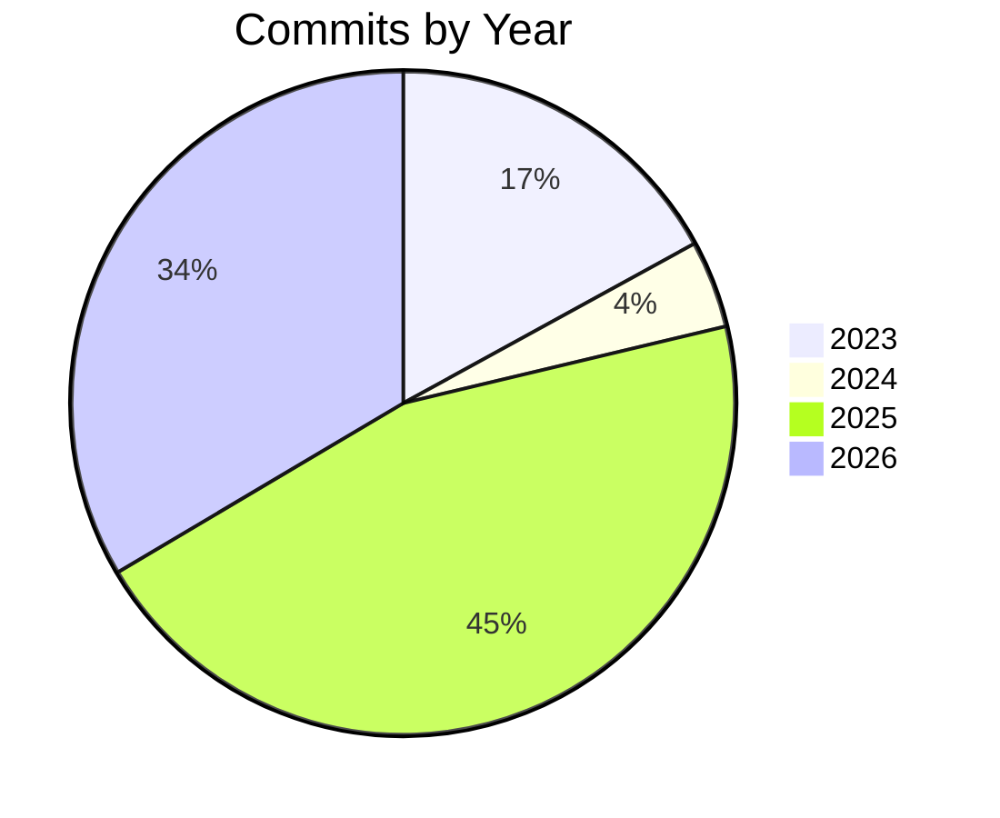

# Solution Digest

## Summary

WordWheelPlayer is a .NET 10 console application that simulates the newspaper word wheel puzzle. Players are given nine letters with a central key letter and must find as many valid English words (3–9 letters) as possible, each containing the key letter. The solution includes a comprehensive xUnit v3 test suite covering the game engine, dictionary, and helper logic.

## Languages

| Language | Extension(s) |
|----------|-------------|
| C# | .cs |
| JSON | .json |

## Modules

| Language | Count |
|----------|-------|
| C# | 36 |
| JSON | 2 |

## Unit Tests

| Metric | Value |
|--------|-------|
| Total tests | 106 |
| Framework | xUnit v3 |

## Development History

| Metric | Value |
|--------|-------|
| Total commits | 188 |
| First commit | Thursday, 2 February 2023 |
| Last commit | Friday, 6 November 2026 |
| Days | 1373 |
| Weeks | 196 |
| Months | 45 |
| Years | 3 |

## Commits by Year

